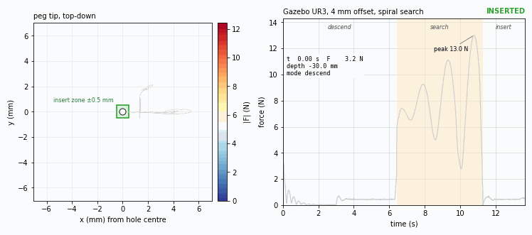
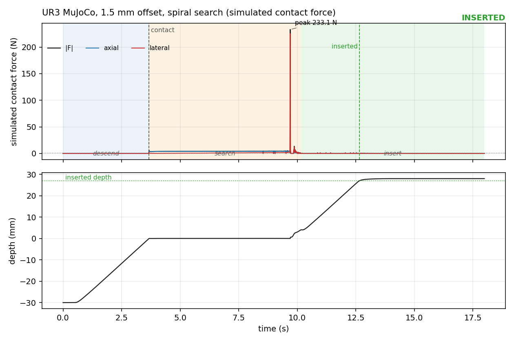
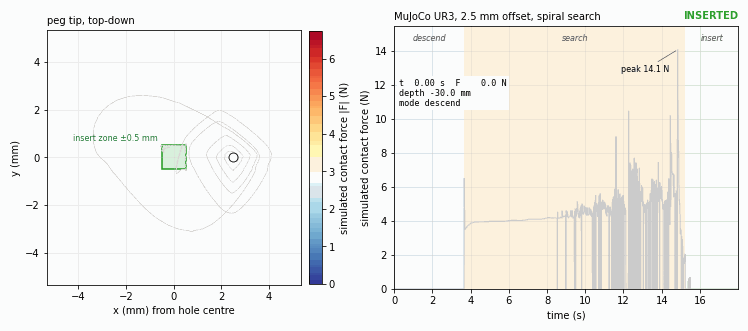
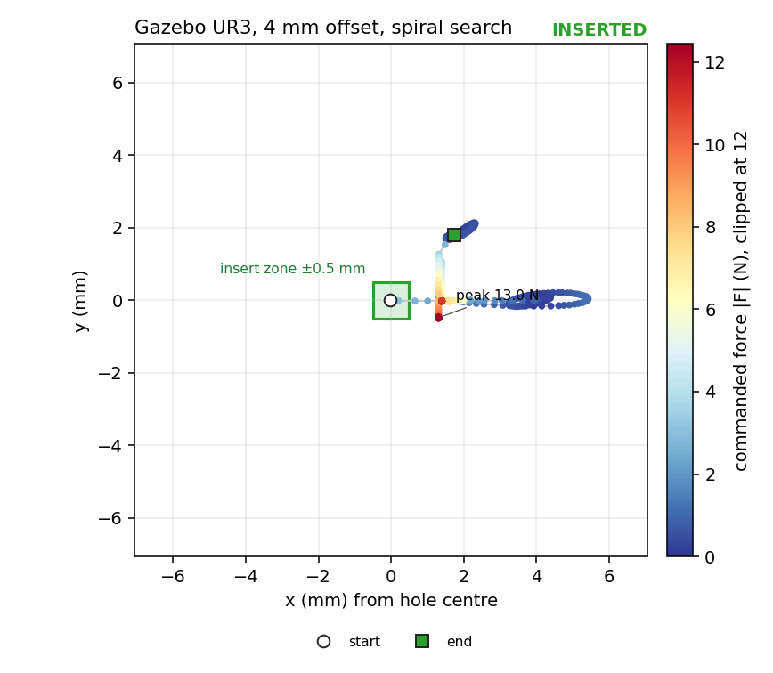
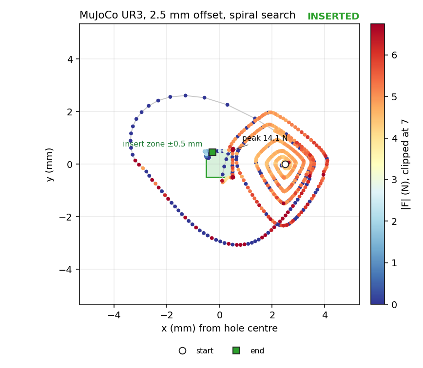
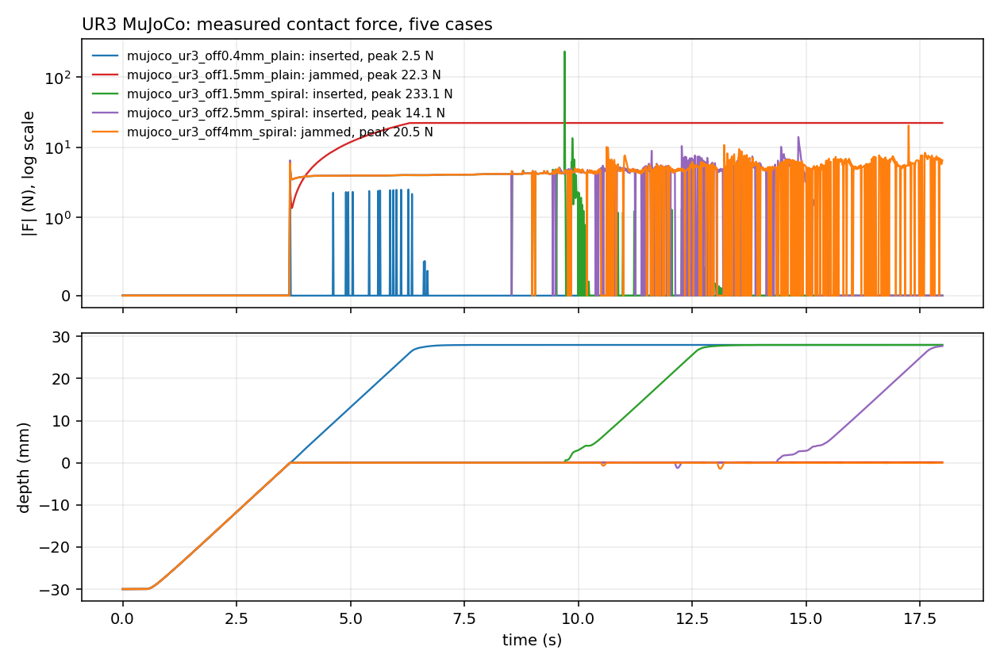
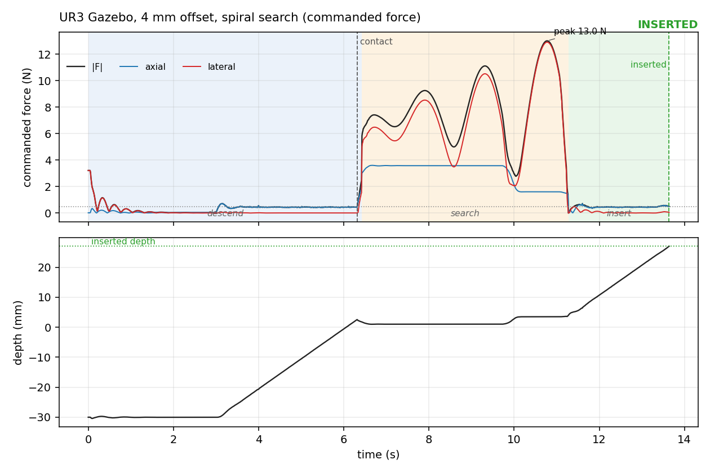

# forcetrace

[](https://github.com/darshmenon/forcetrace/actions/workflows/ci.yml) [](https://github.com/darshmenon/forcetrace/releases) [](LICENSE) 

Contact-force metrics and plots for robot manipulation runs. Point it at a CSV from a peg-in-hole (or any press, insert, or push) run and get peak force, impulse, time in contact, insertion time, jam detection, overshoot and settling time, plus an annotated plot, a top-down contact map, an animated GIF and a one-file HTML dashboard. No ROS needed: numpy and matplotlib only.



## Quick start

```bash
pip install git+https://github.com/darshmenon/forcetrace.git      # Python 3.10+, installs the `forcetrace` command
forcetrace --version

git clone https://github.com/darshmenon/forcetrace.git && cd forcetrace    # the example logs live in the repo
forcetrace analyze examples/data/gazebo_ur3_off4mm_spiral.csv
forcetrace animate examples/data/gazebo_ur3_off4mm_spiral.csv --hole 0.28 0.14 --out run.gif
```

```
gazebo_ur3_off4mm_spiral.csv
  verdict                 INSERTED
  duration                13.639 s
  peak force              13.009 N
  ...
```

Your own CSV needs a time column and a force column (`f_axial`, `f_lateral` or `force`); other headers can be mapped with `--cols`. Add `--json -` to any `analyze` or `compare` for strict JSON on stdout (non-finite values become `null`), and `python3 -m forcetrace` works without installing the script.

## All commands

```bash
pip install -e .                                   # from a clone, for development (pip install -e ".[test]" then pytest)
forcetrace analyze run.csv --plot run.png --json run.json
forcetrace analyze run.csv --modes 0:descend,1:search,2:insert --plot run.png   # label task phases (needs a mode column)
forcetrace compare a.csv b.csv c.csv --out compare.png --logy
forcetrace analyze run.csv --cols t=time,f_axial=Fz,f_lateral=Fxy,depth=d        # map your own headers
forcetrace map run.csv --hole 0.28 0.14 --out map.png                            # top-down, colour = force
forcetrace animate run.csv --hole 0.28 0.14 --out run.gif                        # path + force vs time, with phase bands
forcetrace dashboard a.csv b.csv c.csv --hole 0.28 0.14 --out dash.html          # metric cards + overlaid plots, no CDN
```

Bad input exits with code 2 and a one-line message (missing file, a directory, a non-text file, missing columns). Rows containing NaN or inf are dropped with a note on stderr.



## Visualizations

The three views need the tip position (`x`, `y` columns; also `tip_x`, `pos_x`, ...). `--hole X Y` gives the hole centre in the log's frame so the path is drawn relative to it. The green square is the **insert zone**: the hole half-width minus the peg radius (`--hole-half` 0.0105 m, `--peg-radius` 0.01 m, so ±0.5 mm), i.e. where the tip centre has to be for the peg to drop in. Colour runs from blue (light touch) to red (hard contact) and is clipped at the 98th percentile of the force so one wall spike does not wash out the rest.

**Animated run** (`forcetrace animate`): the tip path fills in coloured by force on the left; force vs time with a moving cursor on the right, shaded by task phase (`--modes 0:descend,1:search,2:insert`, the default; `--modes ''` for none).




**Contact map** (`forcetrace map`): the whole path at once, strongest contact drawn on top, with start, end and peak marked.



The Gazebo map shows something the force plot does not: the peg ended about 1.7 mm and 1.8 mm from the hole centre, well outside the ±0.5 mm zone, and the run still counts as inserted. That is the soft Gazebo contact noted in the UR3 repo, visible at a glance.



**Dashboard** (`forcetrace dashboard`; live examples: [Gazebo](https://darshmenon.github.io/forcetrace/dashboard_gazebo.html), [MuJoCo](https://darshmenon.github.io/forcetrace/dashboard_mujoco.html)): one HTML file with a card per run (verdict and key metrics), overlaid force, depth and top-down plots, hover read-outs, click a card to hide a run, and a log-scale toggle (on by default when one spike dominates). Data is embedded and drawn as inline SVG, so it works offline and makes no network requests. Open [docs/dashboard_mujoco.html](docs/dashboard_mujoco.html) or [docs/dashboard_gazebo.html](docs/dashboard_gazebo.html) in a browser (GitHub shows the source, so download them first).

## What it reports

| Metric | Meaning |
|---|---|
| `peak force`, `peak axial`, `peak lateral` | largest force, in total and per channel (N) |
| `impulse in contact` | integral of force over the time in contact (N*s) |
| `time in contact`, `first contact at` | axial force above `--contact-n` (0.5 N) and, with a depth column, within `--surface-tol` (2 mm) of the surface |
| `inserted at`, `contact to insertion` | first time depth reaches `--insert-depth` (0.027 m) and how long after first contact |
| `jammed since` | never inserted, and in contact for `--jam-time` (3 s) with under 1 mm of depth gained |
| `steady axial force`, `axial overshoot`, `settling time` | median axial force over the last 20% of the contact segment, how far the peak exceeds it, and when the force stays within 5% (at least 0.1 N) of it |

Input columns (case-insensitive, or map them with `--cols`): `t` (`time`), `f_axial` (`fz`), `f_lateral` (`fxy`), `force` (magnitude; derived from the other two when absent), `depth`, `z` (with `--surface-z`), `x` and `y` (for `map`, `animate`, `dashboard`), `mode`. Depth is 0 at the hole's top face and negative above it. Bad input exits 2 and names the headers it found.

## Results on the UR3 peg-in-hole logs

All numbers below come from `examples/data` (UR3, K = 800 N/m, 10 mm/s descent). Regenerate with `forcetrace compare examples/data/gazebo_*.csv` and `examples/data/mujoco_*.csv`; full output is in `docs/*_metrics.json`.

**MuJoCo, simulated contact force** (`examples/export_mujoco_ur3.py` runs the env in `ur_force_control` and now also writes the tip `x`, `y`):

| Case | Verdict | Peak force | Impulse | Contact to insertion |
|---|---|---|---|---|
| 0.4 mm offset, plain descent | inserted | 2.5 N | 0.33 N*s | 2.8 s |
| 1.5 mm offset, plain descent | jammed | 22.3 N | 292 N*s | - |
| 1.5 mm offset, spiral search | inserted | **233 N** (225 N lateral) | 27.6 N*s | 9.0 s |
| 2.5 mm offset, spiral search | inserted | 14.1 N | 47.2 N*s | 14.1 s |
| 4 mm offset, spiral search | not inserted (flagged jammed) | 20.5 N | 61.1 N*s | - |



The 233 N row is a finding, not a bug in the tool: the spiral search in that run slams the peg into the hole wall once, and the other four cases peak at 22 N or less. A summary that only reports success would hide it. The 4 mm case is the known unrecovered one.

**Gazebo, commanded force** (the logs hold the impedance controller's spring force `K (x_des - x)`, not a measured contact force):

| Case | Verdict | Peak force | Impulse | Contact to insertion |
|---|---|---|---|---|
| 0.4 mm offset, plain descent | inserted | 0.75 N | 0.06 N*s | 2.7 s |
| 4 mm offset, plain descent | jammed from 6.3 s | 21.7 N | 381 N*s | - |
| 4 mm offset, spiral search | inserted | 13.0 N (12.9 N lateral) | 38.9 N*s | 7.3 s |



## Limits

- **The animation and dashboard need an `x`/`y` position**; without it `map` and `animate` exit 2 with a message, and the dashboard shows force and depth only.
- **Animated GIFs are 8 s of playback by default** (`--seconds`, `--fps`), so a long run is time-compressed; the cursor shows real log time.
- **Contact is inferred from force and depth**, so it is only as good as those channels. On commanded-force logs (Gazebo above) "peak force" is what the controller asked for, not what the surface felt.
- **"Jammed" means no depth progress during sustained contact.** A search run that has not inserted by the end of the log is reported as jammed even though it was still searching.
- **Overshoot is reported only when the steady force exceeds the contact threshold**, and on a landing followed by a light press it can be large (the 4 mm MuJoCo case reports 278%: a 19 N landing against a 5 N press). Read it together with the plot.
- The depth gate assumes depth 0 is the surface. Logs with another convention need `--no-depth-gate` or a z column with `--surface-z`.
- Metric choices (peak and mean force, assembly time, success, force energy) follow what insertion benchmarks commonly report; there is no single standard, so thresholds are options.
